# Lab 3: Design a Migration Strategy

### Lab overview

**Scenario.** Zava Retail sells home and lifestyle products through 140 stores and an online store that runs around the clock. Every sale, from store tills and the website, is written to one SQL Server database in a co-located datacenter whose contract ends in six months.

Leadership has chosen Azure SQL Database to cut hardware and patching work for a two-person DBA team. The business has set two limits: the finance reporting copy can be offline over a weekend, but the live order system can stop taking orders for no more than 15 minutes, inside a Sunday 02:00 maintenance window.

You are the migration engineer running the pilot. Before the full migration is approved, you must prove three things: which tool and target fit the database, how offline and minimal-downtime migrations compare in real downtime, and that a gated cutover with a rollback path stays inside the 15-minute limit.

### Objectives

By the end of the lab you will be able to:

- Set up a source database and Azure SQL targets
- Evaluate and provision migration tooling
- Run offline and minimal-downtime migrations to Azure SQL Database
- Run readiness checks and execute a cutover

[!Note] **How this lab uses Azure Database Migration Service (DMS):** for Azure SQL Database targets, DMS supports offline migrations only. In this lab, DMS runs the **offline** migration. The minimal-downtime migration uses a Change Tracking sync, which shows the seed, sync and cutover pattern that online tools such as transactional replication and Managed Instance link automate.

### **Verify the tools (1 minute).** 

1. Open **Windows PowerShell as Administrator** and run:
  
    ```
    sqlcmd -? | Select-Object -First 2  
    bcp -v  
    sqlpackage /version  
    az version --output table
    ```
    
    Each command should print a version.
    
    

    **If SqlPackage is not recognised or fails with "You must install or update .NET".** SqlPackage 170.x runs on .NET 10 and needs the latest .NET 10 runtime under **C:\Program Files\dotnet.** Run these steps in order, in the same Administrator PowerShell window:

1. Install the latest .NET 10 SDK and runtime machine-wide:

    `winget install Microsoft.DotNet.SDK.10 --accept-source-agreements --accept-package-agreements`
   
    `winget install Microsoft.DotNet.Runtime.10 --accept-source-agreements --accept-package-agreements`
    
    
    
    
    
    

1. Install SqlPackage as a .NET global tool, or update it if it is already there:

    `dotnet tool update -g microsoft.sqlpackage`
    
    

1. Add the tools folder to this window's PATH so you do not need to reopen PowerShell:

    `$env:Path += ";$env:USERPROFILE\\dotnet\tools"`
    
    

1. Verify:

    `dotnet --list-runtimes`
   
    `sqlpackage /version`
    
    
    
    **Expected result:** the runtime list includes a Microsoft.NETCore.App 10.0.x version at least as high as the one in any earlier error message, and SqlPackage prints its version (for example 170.5.96).

**Keep one PowerShell window open for the whole lab.** Later steps reuse variables set in Exercise 0. If you close the window, rerun Exercise 0, Task 1 (variables only) before continuing.


## Exercise 0: Set up the source database and Azure SQL targets

You create ZavaOrders on the local SQL Server with 1,000 customers and 20,000 orders, then start deploying two empty Azure SQL databases: one for the offline migration and one for the minimal-downtime migration.

### Task 1: Set lab variables

1. Run the PowerShell window, run the block below. :

    ```
    New-Item -ItemType Directory -Path C:\Lab3 -Force | Out-Null  
    Set-Location C:\Lab3  
    $rg = "rg-lab3-"  
    $loc = "centralindia"  
    $server = "sql-lab3-" + (Get-Random -Maximum 9999)  
    $admin = "labadmin"  
    $sqlPass = Read-Host "Enter SQL admin password"  
    $azHost = "$server.database.windows.net"  
    $server
    ```

    Enter a strong password when prompted (12+ characters, upper, lower, number, symbol) as `Zava#Lab2026!`

    

1. Write the **server’s name** on the notepad. If you reopen PowerShell later, set $server back to this exact name instead of generating a new one.

    >[!Note] Make sure don’t close the powershell. Keep it open.

    


### Task 2: Start the Azure deployment

1. Start this now; the databases deploy while you build the source. Run this command in the same powershell window:

    ```
    az login
    # One-time per subscription: register the resource providers this lab uses (1-3 min)
    az provider register --namespace Microsoft.Sql --wait
    az provider register --namespace Microsoft.DataMigration --wait
    az provider show -n Microsoft.Sql --query registrationState -o tsv
    az provider show -n Microsoft.DataMigration --query registrationState -o tsv
    az group create -n $rg -l $loc -o table
    az sql server create -g $rg -n $server -l $loc -u $admin -p $sqlPass -o table
    $myip = (Invoke-RestMethod https://api.ipify.org)
    az sql server firewall-rule create -g $rg -s $server -n AllowLabVM --start-ip-address $myip --end-ip-address $myip -o table
    foreach ($db in "ZavaOrders_Offline","ZavaOrders_Online") {
    az sql db create -g $rg -s $server -n $db --edition GeneralPurpose --compute-model Serverless --family Gen5 --capacity 2 --auto-pause-delay 60 --no-wait
    }
    ```

    The server takes about 1 to 2 minutes. The two az sql db create calls return at once and keep deploying in the background. Both provider checks must print Registered before the server is created; without them the server create fails with MissingSubscriptionRegistration.

    

    

    The server takes about 1 to 2 minutes. The two **az sql db** create calls return at once and keep deploying in the background.

    

    **If nothing happens for more than 10 minutes**, press **Ctrl+C**, then check:

    `az provider show -n Microsoft.Sql --query registrationState -o tsv`

    

    Everything worked:
    - Both providers show Registered.
    - The resource group rg-lab3-sd was created.
    - The SQL server **sql-lab3-sd-1186** was created. Note this name down.
    - The firewall rule Allow lets your VM’s IP connect.

    Once the prompt is back, check that both databases are deploying:

    `az sql db list -g $rg -s $server --query "[?name!='master'].{name:name, status:status}" -o table`

    You should see **ZavaOrders_Offline** and **ZavaOrders_Online**, either Online already or still being created. If they’re still being created, they’ll finish in the background. Either way, you can continue with **Task 3**.

    


### Task 3: Build the source database

**Before you start, check the source SQL Server.** Every source command in this lab connects to $src, which Task 1 set to localhost (the default instance). 

1. Run:

   ```
   Get-Service | Where-Object { $_.Name -like 'MSSQL*' } | Format-Table Name, Status -AutoSize
   ```

   ```
   sqlcmd -S $src -E -C -W -Q "SELECT @@SERVERNAME AS ServerName, SERVERPROPERTY('ProductVersion') AS Version, IS_SRVROLEMEMBER('sysadmin') AS IsSysadmin;"
   ```

    **Result:** You’ll see that Server is not found or not accessible. Proceed with installing SQL Server first.
    
    
    
    **Install SQL Server Developer (only if no MSSQL service exists).** This takes 10 to 20 minutes. The Basic install creates the default instance MSSQLSERVER and adds your Windows account to the sysadmin role, which is what this lab expects.
    
    Do not use winget or a previously saved SQL2022-SSEI-Dev.exe: that installer has been retired and stops with "This version of the installer is no longer supported". Use the current installer from Microsoft instead:

1. In the VM's browser, open +++https://www.microsoft.com/sql-server/sql-server-downloads+++. In the **Developer** section, choose **Enterprise Developer** and the installer file will be downloaded.

    

1. Run the downloaded installer (for example SQL2025-SSEI-EntDev.exe) as administrator. Choose **Basic**, accept the licence terms, keep the default install location, and select **Install**.

    

1. Wait for **Installation has completed successfully**, then close the installer.

    

1. Confirm the service is running and connect:

    ```
    Get-Service MSSQLSERVER
    $src = "localhost"
    sqlcmd -S $src -E -C -Q "SELECT @@SERVERNAME AS ServerName, SERVERPROPERTY('ProductVersion') AS Version, IS_SRVROLEMEMBER('sysadmin') AS IsSysadmin;"
    ```

    

    

    

1. **NOTE**: If setup asks you to restart, restart the VM, open PowerShell as Administrator, and rerun Exercise 0, Task 1 with $server set to your noted server name and the same password. Your Azure resources from Task 2 are not affected.

    Continue only when the check returns a server name and IsSysadmin = 1.

1. Create the setup script and run it against the local instance:

    ```
    @'
    IF DB_ID('ZavaOrders') IS NOT NULL
    BEGIN
    ALTER DATABASE ZavaOrders SET SINGLE_USER WITH ROLLBACK IMMEDIATE;
    DROP DATABASE ZavaOrders;
    END
    GO
    CREATE DATABASE ZavaOrders;
    GO
    USE ZavaOrders;
    GO
    CREATE TABLE dbo.Customers(
    CustomerID   INT IDENTITY(1,1) PRIMARY KEY,
    CustomerName NVARCHAR(100) NOT NULL,
    City         NVARCHAR(50)  NOT NULL,
    ModifiedDate DATETIME2 NOT NULL DEFAULT SYSUTCDATETIME());
    CREATE TABLE dbo.Orders(
    OrderID      INT IDENTITY(1,1) PRIMARY KEY,
    CustomerID   INT NOT NULL REFERENCES dbo.Customers(CustomerID),
    OrderDate    DATETIME2 NOT NULL DEFAULT SYSUTCDATETIME(),
    Amount       DECIMAL(10,2) NOT NULL,
    ModifiedDate DATETIME2 NOT NULL DEFAULT SYSUTCDATETIME());
    GO
    WITH n AS (SELECT TOP (1000) ROW_NUMBER() OVER (ORDER BY (SELECT NULL)) AS i
            FROM sys.all_objects a CROSS JOIN sys.all_objects b)
    INSERT dbo.Customers(CustomerName, City)
    SELECT CONCAT(N'Customer ', i), CHOOSE(i % 4 + 1, N'Delhi', N'Mumbai', N'Pune', N'Bengaluru') FROM n;
    GO
    WITH n AS (SELECT TOP (20000) ROW_NUMBER() OVER (ORDER BY (SELECT NULL)) AS i
            FROM sys.all_objects a CROSS JOIN sys.all_objects b)
    INSERT dbo.Orders(CustomerID, Amount)
    SELECT (i % 1000) + 1, CAST((i % 500) + 10.50 AS DECIMAL(10,2)) FROM n;
    GO
    -- A legacy reporting view that reads instance-level metadata
    CREATE VIEW dbo.vServerLogins AS
    SELECT name, type_desc FROM master.sys.server_principals;
    GO
    '@ | Set-Content C:\Lab3\01_source.sql

    sqlcmd -S $src -E -C -b -i C:\Lab3\01_source.sql
    ```
  
    

1. Confirm the row counts:

    `sqlcmd -S $src -d ZavaOrders -E -C -Q "SELECT (SELECT COUNT(*) FROM dbo.Customers) AS Customers, (SELECT COUNT(*) FROM dbo.Orders) AS Orders;"`

    

    **Expected result:** Customers = 1000, Orders = 20000.

    The view dbo.vServerLogins is intentional. It stands in for the kind of legacy object that decides which tool and target you can use; you will find it in Exercise 1.


## Exercise 1: Evaluate and provision migration tooling

You profile the source, hit a real SqlPackage export blocker and resolve it, then provision Azure Database Migration Service (DMS) and connect it to your SQL Server through a self-hosted integration runtime, ready for the offline migration in Exercise 2.

### Task 1: Profile the source

1. Run the profiling queries:

    ```
    sqlcmd -S $src -d ZavaOrders -E -C -Q "EXEC sp_spaceused;"
    sqlcmd -S $src -d ZavaOrders -E -C -Q "SELECT type_desc, COUNT(*) AS Objects FROM sys.objects WHERE is_ms_shipped = 0 GROUP BY type_desc;"
    sqlcmd -S $src -d ZavaOrders -E -C -W -Q "SELECT OBJECT_SCHEMA_NAME(object_id) + '.' + OBJECT_NAME(object_id) AS ObjectName FROM sys.sql_modules WHERE definition LIKE '%master.%' OR definition LIKE '%msdb.%' OR definition LIKE '%tempdb.%';"
    ```

    

1. Record on your lab sheet: database size, number of user tables, and any cross-database references.

    **Expected result:** about 16 MB, 2 user tables and 1 view, and one blocker: **dbo.vServerLogins** reads **master.sys.server_principals**. Size tells you whether a quick offline copy is realistic. The object count sets what you must migrate and validate. The blocker matters because Azure SQL Database can’t query master, so the view must be fixed or the target changed. You’ll see it stop the export in Task 2.


### Task 2: Try an offline export with SqlPackage

1. Attempt a BACPAC export:

    `sqlpackage /Action:Export /SourceServerName:localhost /SourceDatabaseName:ZavaOrders /SourceTrustServerCertificate:True /TargetFile:C:\Lab3\ZavaOrders.bacpac`

    

1. Read the error. **Expected result:** the export fails with error SQL71562. SqlPackage reports that vServerLogins has an unresolved reference to master.sys.server_principals and that external references are not supported. A BACPAC must be self-contained, and Azure SQL Database has no instance-level master to query.

    

1. Make the migration decision. You have two options:

    - **Change the target** to Azure SQL Managed Instance, which keeps
    instance-level features and cross-database queries.

    - **Remediate the object** and keep Azure SQL Database as the target.

    Zava's reporting team confirms the view is an unused admin report. Remediate it:

    `sqlcmd -S localhost -d ZavaOrders -E -C -Q "DROP VIEW dbo.vServerLogins;"`

    


1. Rerun the export and note that the blocker is gone:

  ```
  $exportTime = Measure-Command { sqlpackage /Action:Export /SourceServerName:$src /SourceDatabaseName:ZavaOrders /SourceTrustServerCertificate:True /TargetFile:C:\Lab3\ZavaOrders.bacpac | Out-Host }

  "Export took {0:N0} seconds" -f $exportTime.TotalSeconds

  Get-Item C:\Lab3\ZavaOrders.bacpac | Select-Object Name, @{n='SizeKB';e={[int]($_.Length/1KB)}}
   ```

  **Expected result:** the export succeeds and the BACPAC file exists. The database is now free of blockers for Azure SQL Database, so any tool, including DMS, can migrate it.

  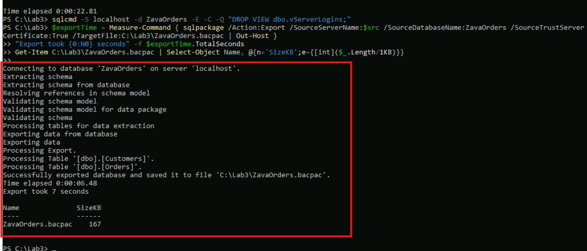


### Task 3: Provision Azure Database Migration Service

SqlPackage runs on your VM and connects to both ends directly. DMS is an Azure service: it orchestrates and monitors migrations, and reaches on-premises sources through a self-hosted integration runtime that you install near the source.

1. Create the DMS instance in your lab resource group:

    ```
    az config set extension.use_dynamic_install=yes_without_prompt
    $dms = "dms-lab3-" + (Get-Random -Maximum 9999)
    az datamigration sql-service create --resource-group $rg --sql-migration-service-name $dms --location $loc -o table
    ```

    

1. Check its state and retrieve the integration runtime authentication keys:

  
    `az datamigration sql-service show --resource-group $rg --sql-migration-service-name $dms -o jsonc`
   
    `az datamigration sql-service list-auth-key --resource-group $rg --sql-migration-service-name $dms -o table`
  

    **Expected result:** provisioningState is Succeeded, the integration runtime state shows it still needs registration, and two authentication keys are returned. Treat the keys as secrets.

    

1. In the **Azure portal**, open your resource group.

    

1. Select the DMS resource and review its integration runtime status on the **Overview** page.

    

    The Overview page shows what the CLI reported:
    - **Integration Runtime State: “Integration Runtime not registered”.**
    This is the same status as NeedRegistration in PowerShell. DMS can’t reach an on-premises SQL Server until a self-hosted integration runtime is installed near the source and registered with one of the auth keys.

    - **Target: Azure SQL.** The service is ready to run migrations into
    Azure SQL once a runtime is connected.

    

1.	Install the self-hosted integration runtime. On the DMS resource, under **Settings**, select **Integration runtime**. Select Configure integration runtime.

   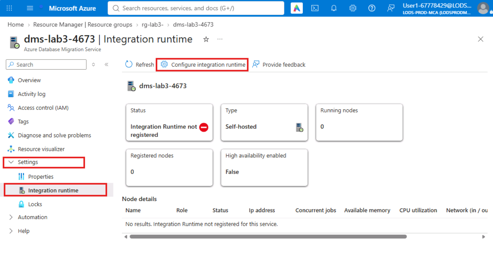
   
3.	Then, select the **Download and install integration runtime** link. It opens the download page in the VM's browser.

   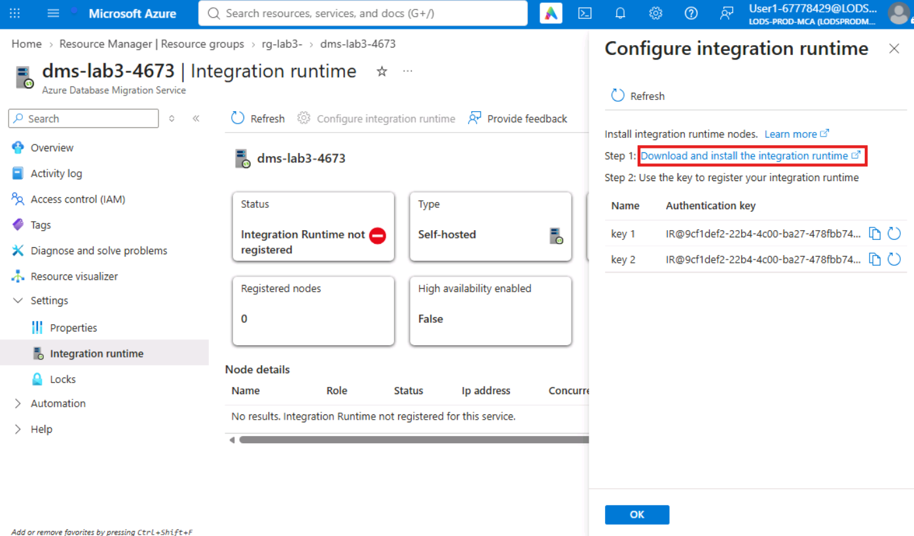
  	
5.	**Download** the integration runtime installer and run it on the lab VM, accepting the defaults. When installation finishes, **Microsoft Integration Runtime Configuration Manager** opens automatically.

   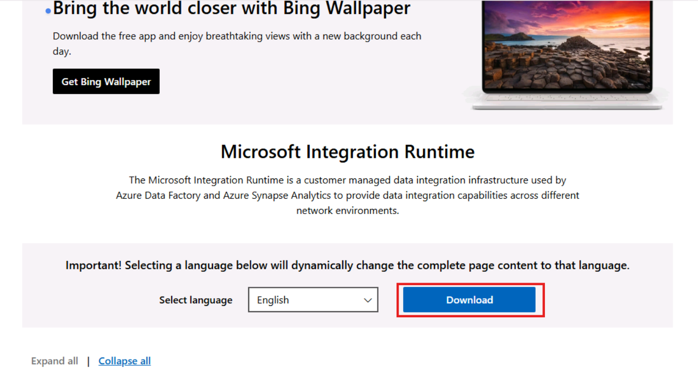

  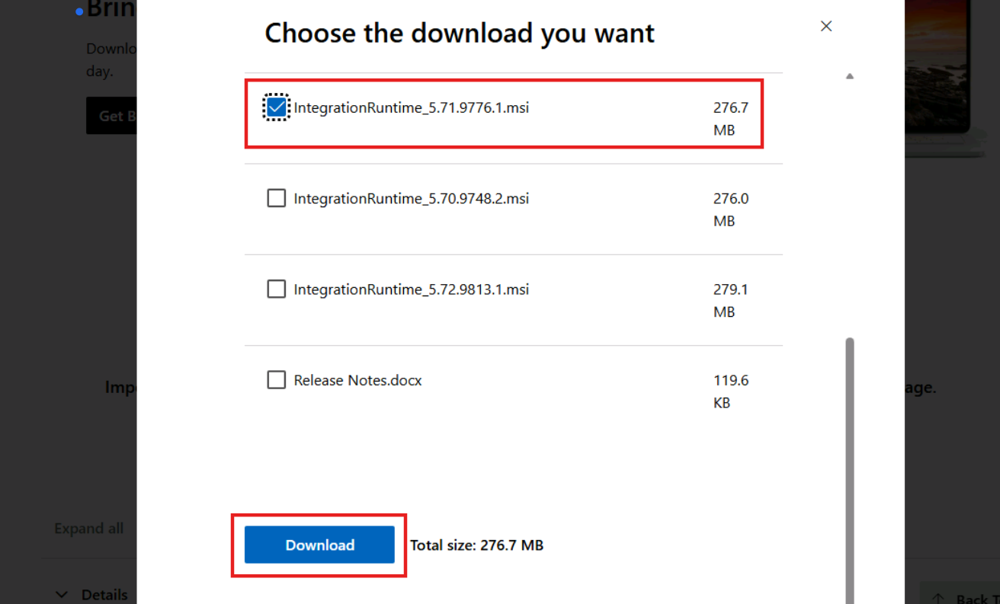
   
7.	Back in the portal, in the **Authentication key** table, copy one of the keys.

   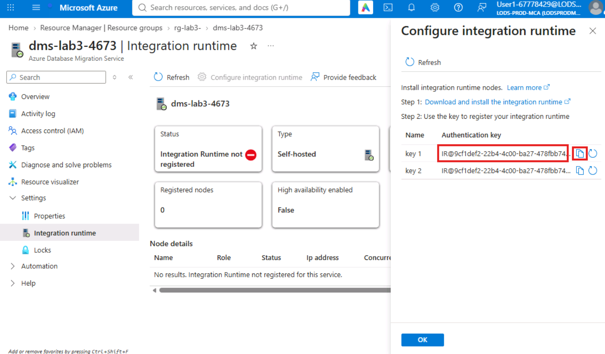
  	
9.	Paste it into the Configuratio¬¬n Manager, wait for the green check that shows the key is valid, then select **Register**. When registration completes, close the Configuration Manager.

   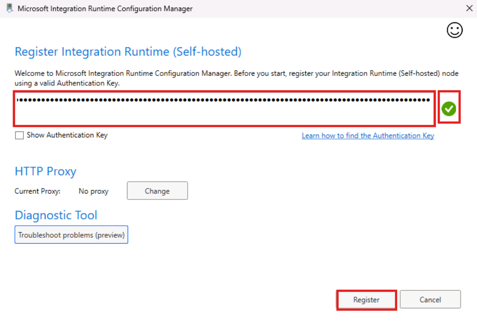
  
  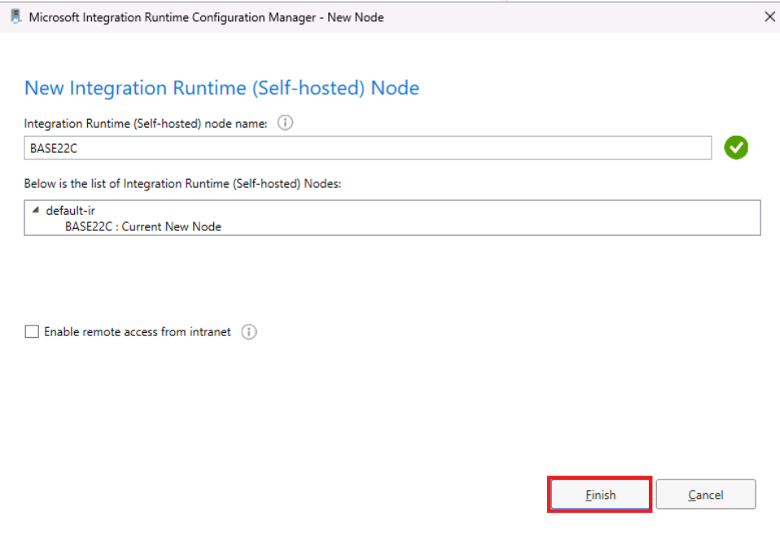
  
  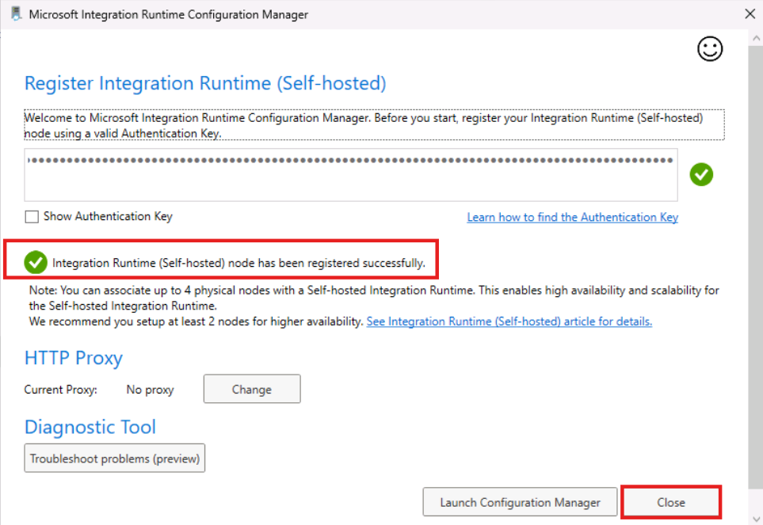
    
11.	Confirm the runtime is connected. In the portal, go to **Settings > Integration runtime** and select **Refresh** until your VM appears as a node; this can take several minutes. 

  **You can also check from PowerShell:** 
  +++az datamigration sql-service show --resource-group $rg --sql-migration-service-name $dms --query integrationRuntimeState -o tsv+++
  
  **Expected result:** Online.
  
  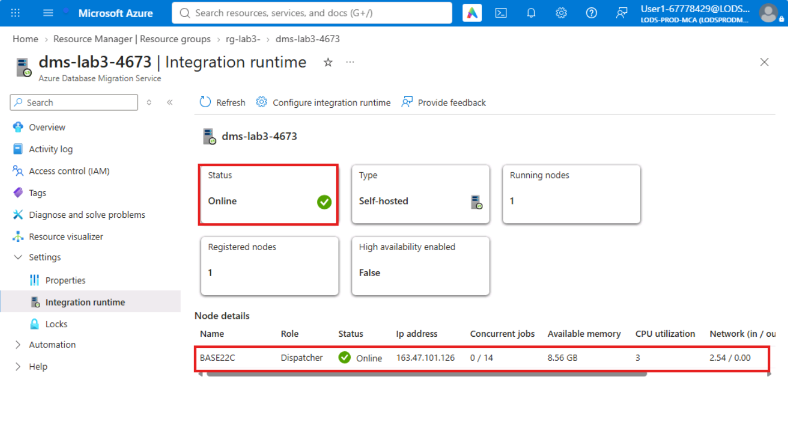

12.	Let the integration runtime connect to SQL Server over TCP. SQL Server Developer edition installs with TCP/IP turned off, and the runtime can't connect without it. 
    **Run:**
   	```
    $key = Get-ChildItem "HKLM:\SOFTWARE\Microsoft\Microsoft SQL Server" | Where-Object { $_.PSChildName -like 'MSSQL*.MSSQLSERVER' } | Select-Object -First 1
    Set-ItemProperty "$($key.PSPath)\MSSQLServer\SuperSocketNetLib\Tcp" -Name Enabled -Value 1
    Restart-Service MSSQLSERVER -Force
    sqlcmd -S tcp:localhost -E -C -W -Q "SELECT 'TCP OK' AS Status;"
    ```
    
    **Expected result:** TCP OK.

  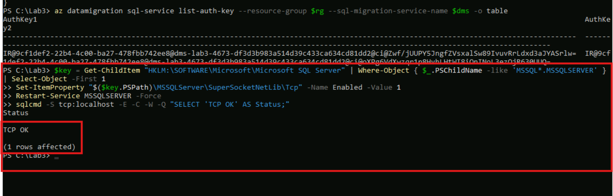

  DMS supports offline migrations to Azure SQL Database, and online or offline migrations to SQL Managed Instance and SQL Server on Azure VMs. That's why Exercise 2   uses DMS for the offline migration, and a Change Tracking sync for the minimal-downtime migration.

## Exercise 2: Run offline and online migrations to Azure SQL Database

You migrate the same database twice. The offline path copies a frozen snapshot; the online path seeds the target, keeps it in sync while the application writes, and leaves only a short final sync for cutover.

### Task 1: Offline migration with BACPAC import

1. Confirm both Azure databases finished deploying (status Online):

    `az sql db list -g $rg -s $server --query "[?name!='master'].{name:name, status:status}" -o table`

    

1. If in case, you databases also shows the status as paused, run the below command to wake them up:

    ```
    foreach ($db in "ZavaOrders_Offline","ZavaOrders_Online") {
    az sql db update -g $rg -s $server -n $db --auto-pause-delay -1 -o none
    }
    ```

    

1. Check the status again to see if databases are now Online:

    `az sql db list -g $rg -s $server --query "[?name!='master'].{name:name, status:status}" -o table`

    

1. Print the connection details you'll enter in the **DMS wizard**:

  ```
  "Source server: localhost   Windows user: $env:COMPUTERNAME\$env:USERNAME"
  "Target server: $azHost   SQL user: $admin"
  ```
	
  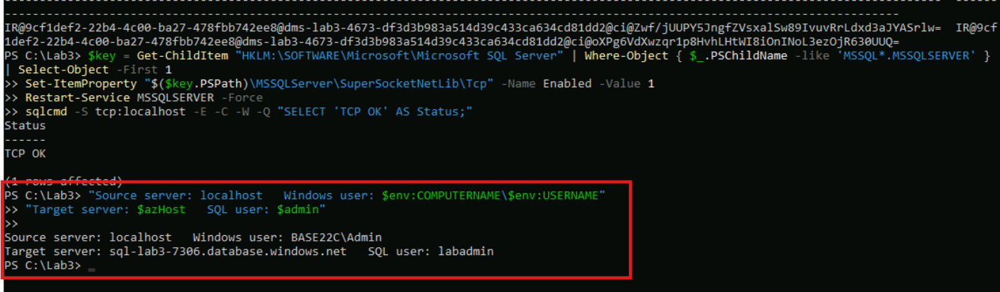

1. In the Azure portal, open your DMS resource. On the **Overview** pane, select **+ New Migration**.
  
   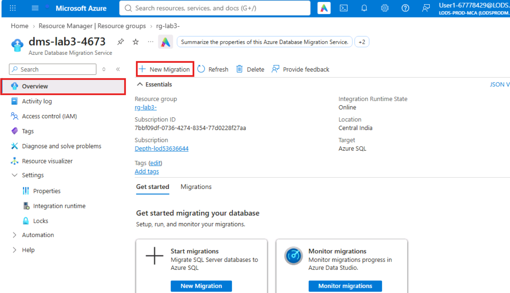

1. Under Select **new migration scenario**, set **Source server type** to **SQL Server**, **Target server type** to **Azure SQL Database**, and **Migration mode** to **Offline**. Choose **Select**. The **Azure SQL Database Offline Migration Wizard** opens.

   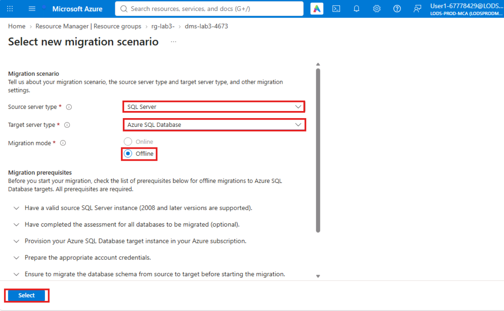

1. On the **Source details** tab, enter the details for your **source SQL Server**(it runs on this lab VM, not in Azure), then select **Next: Connect to source SQL Server.**

  |Field	|What to select or enter|
  |-------|-------|
  |Is your source SQL Server instance tracked in Azure? |No (already selected)	|
  |Source Infrastructure Type |Virtual Machine, since the source runs on your lab VM. If that option isn't in the list, choose Physical Server. This is only a label for tracking and doesn't affect the migration.	|
  |Subscription |Leave your lab subscription (already selected)	|
  |Resource group |Your lab resource group, rg-lab3- (already selected)	|
  |Location |Central India, to match the rest of the lab	|
  |SQL Server Instance Name |Your VM name plus the instance name, as the hint below the field suggests. Get it from PowerShell (below)	|

   To get the **instance name**, run this in your **PowerShell** window:
  +++"$env:COMPUTERNAME-MSSQLSERVER"+++

   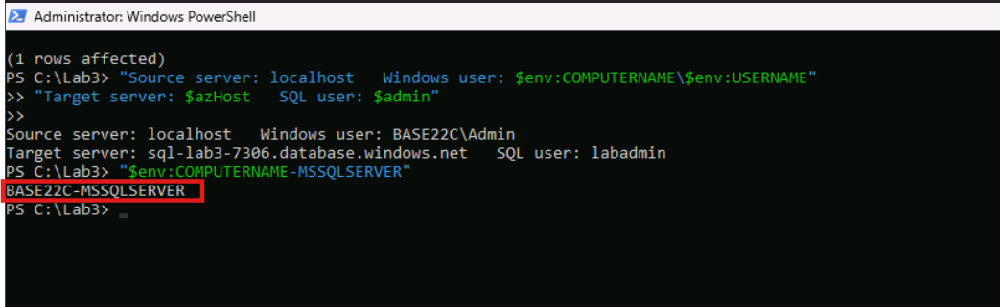
   
   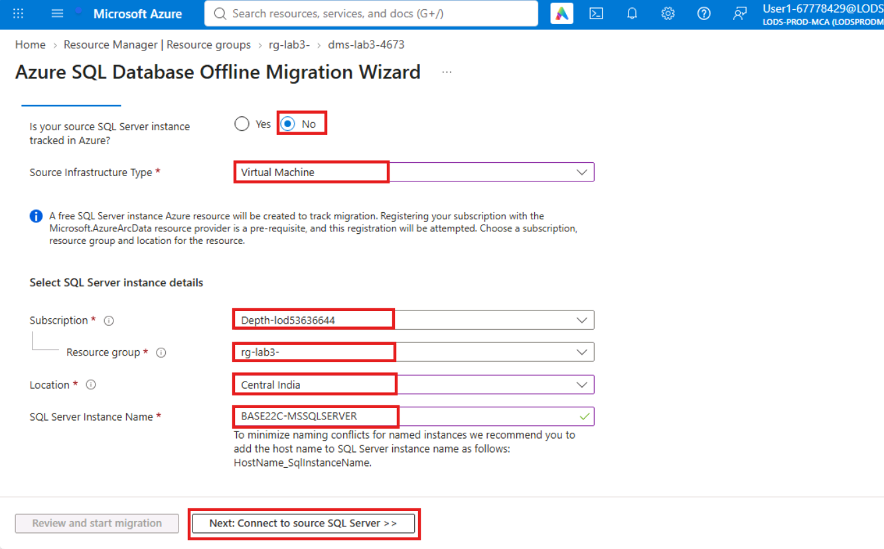

1. On the **Connect to source SQL Server** tab, enter:
   
   - **Source server name:** localhost
   - **Authentication type:** SQL Authentication
   - **User name:**
  
   - **If you don't know the VM password**, you can switch SQL Server to allow SQL logins and create a login just for DMS. Run this in PowerShell:

   ```
	sqlcmd -S $src -E -C -Q "EXEC xp_instance_regwrite N'HKEY_LOCAL_MACHINE', N'Software\Microsoft\MSSQLServer\MSSQLServer', N'LoginMode', REG_DWORD, 2;"
	Restart-Service MSSQLSERVER -Force
	sqlcmd -S $src -E -C -Q "CREATE LOGIN dms_source WITH PASSWORD = 'Zava#Src2026!', CHECK_POLICY = OFF; ALTER SERVER ROLE sysadmin ADD MEMBER dms_source;"
   ```

     Then in the wizard, choose **SQL Authentication**, with user +++dms_source+++ and password +++Zava#Src2026!+++
   
    - Check **Trust server certificate** if the option is shown

      Then select **Next: Select databases for migration**.

  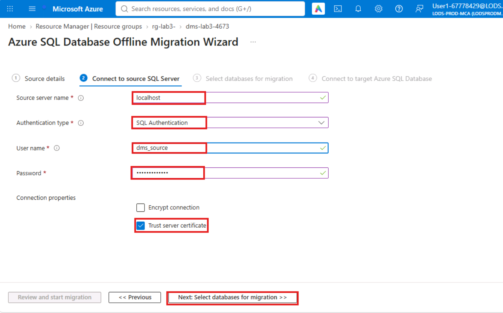

1. On the **Select databases for migration** tab, check **ZavaOrders**. The list can take a moment to fill. Select **Next: Connect to target Azure SQL Database**.

   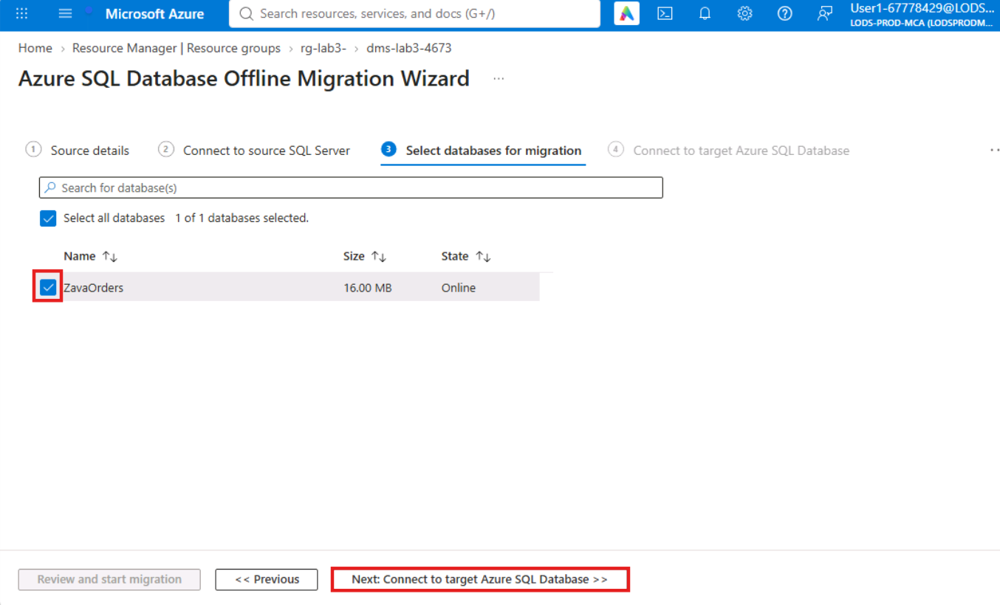

1. On the **Connect to target Azure SQL Database** tab, select your subscription, resource group and SQL server (the target server printed in step 4). Set **Authentication type** to **SQL Authentication**, enter +++labadmin+++ and your SQL admin password as +++Zava#Lab2026!+++, then select **Next: Map source and target databases.**

   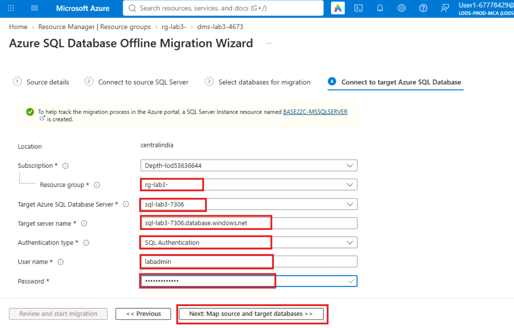

1. On the **Map source and target databases** tab, map **ZavaOrders** to **ZavaOrders_Offline**.

   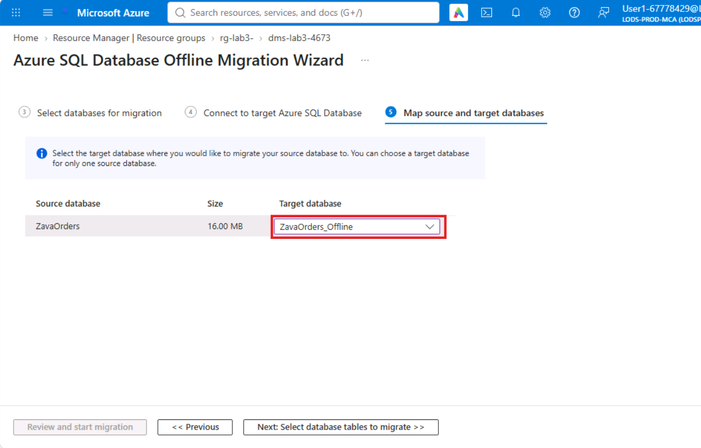

1. Check **Migrate Missing schema**. The target database is empty, so DMS must create the schema before copying data. Then select **Select all tables**, followed by **Next: Database migration summary**.

   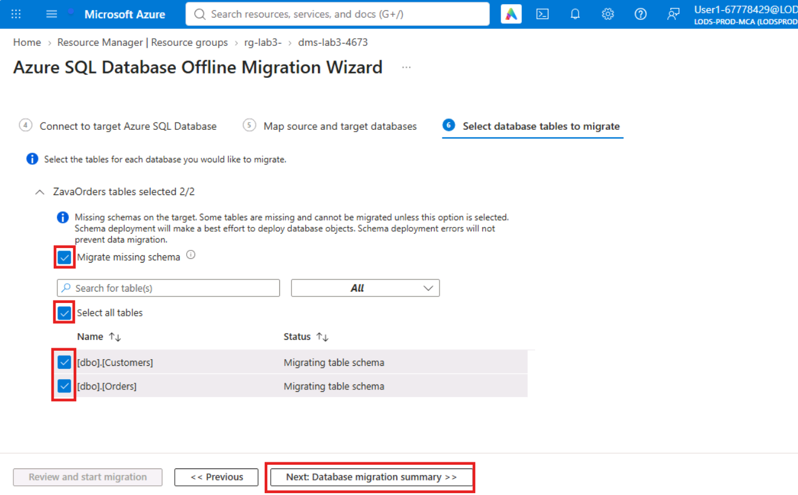

1. In PowerShell, start the downtime clock:
   
   +++$dmsStart = Get-Date+++

   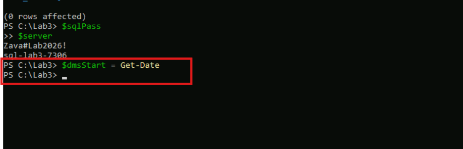

1. Back in the portal, on the **Database migration summary** tab, review the details and select **Start migration**. The portal returns you to the DMS dashboard.

   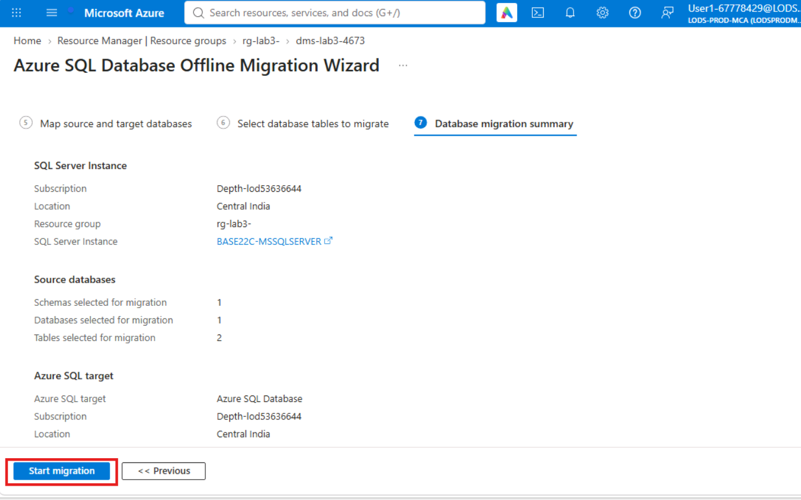

1. On the **Overview** pane of your DMS resource, select **Monitor migrations**. On the **Migrations** tab, select **Refresh** to update the status. It moves through **Creating, Preparing for copy, Copying, Copy finished and Rebuilding indexes**, ending at **Succeeded**. 

   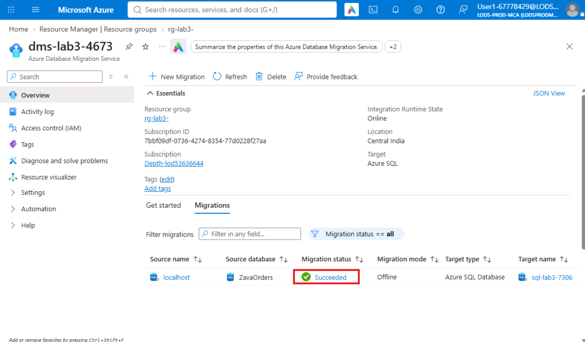

1. To see the status of each table, select **localhost** under **Source name** (or the status link under Migration status). **ZavaOrders** is shown in the **Source database** column.
   
  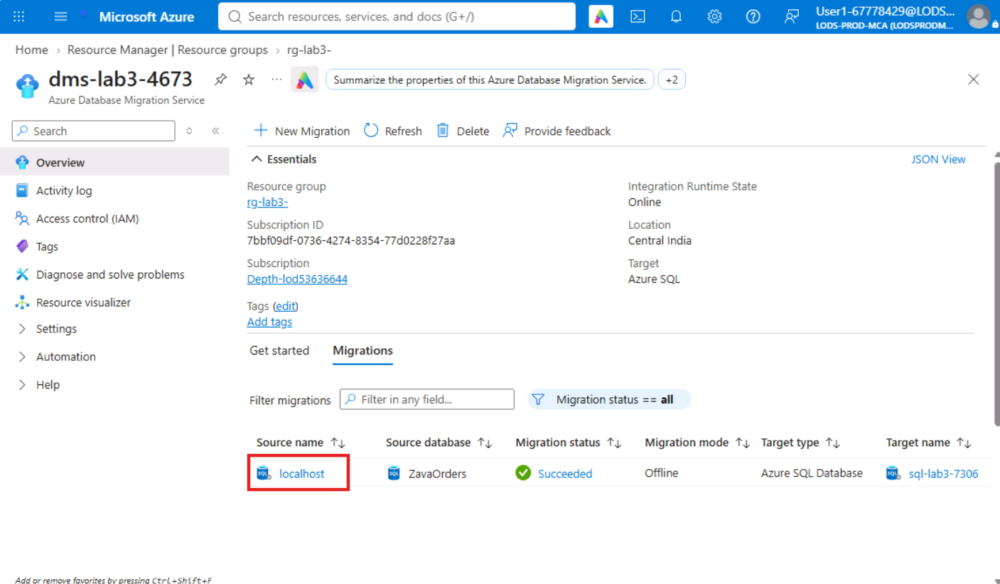
  
  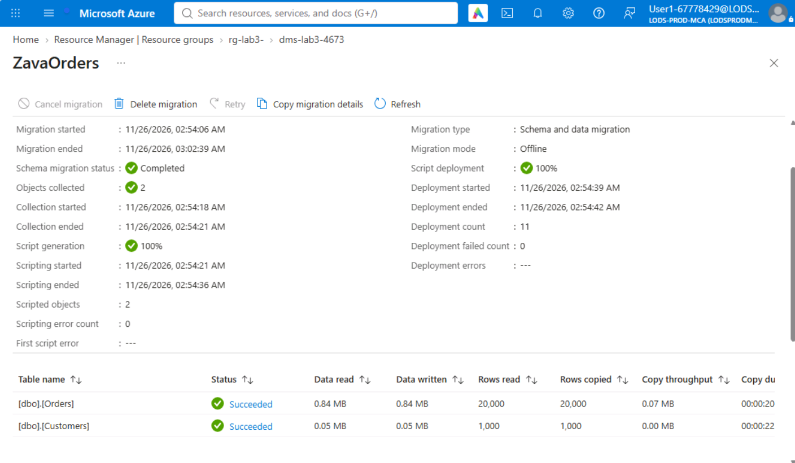

1. When the status shows Succeeded, stop the clock in PowerShell:

  ``` 
  $dmsTime = (Get-Date) - $dmsStart
  "Offline (DMS) downtime: {0:N0} seconds" -f $dmsTime.TotalSeconds
  ```

  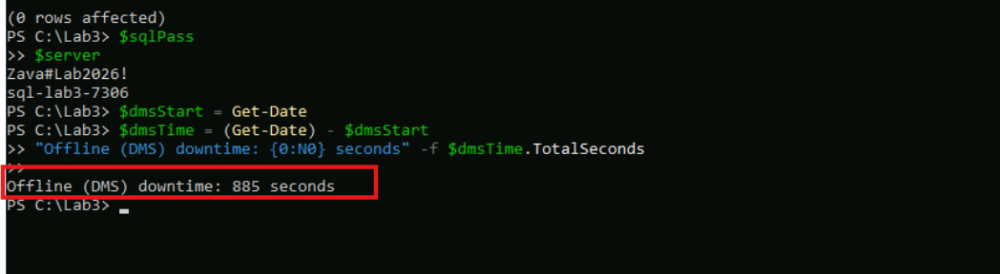

1. Validate the copy:
   
  ++++sqlcmd -S $azHost -d ZavaOrders_Offline -U $admin -P $sqlPass -W -Q "SELECT (SELECT COUNT(*) FROM dbo.Customers) AS Customers, (SELECT COUNT(*) FROM dbo.Orders) AS Orders;"+++

  **Expected result:** Customers = 1000 and Orders = 20000. Record the offline downtime. In production the source would be read-only for that whole window, and it grows with data size. 
  
  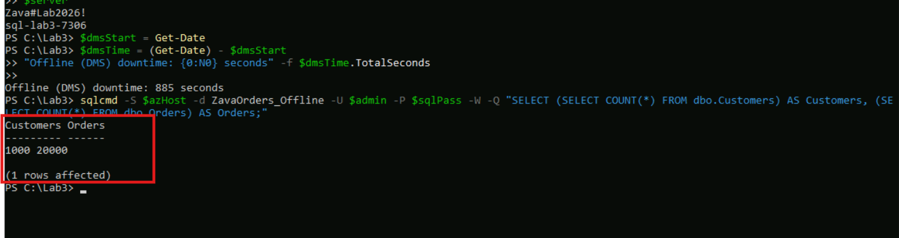

[!Note] **Best practice**: DMS skips tables with no rows, and computed columns aren't migrated. Neither applies to ZavaOrders, but check for both before migrating a real database. In production, use a least-privileged target login with the server roles listed in the DMS documentation instead of the server admin.

### Task 2: Minimal-downtime migration with Change Tracking

1. Deploy the schema only (no data) to the online target. Do this before enabling Change Tracking, so the dacpac carries no tracking settings that Azure SQL Database would reject:

    ```
    sqlpackage /Action:Extract /SourceServerName:$src /SourceDatabaseName:ZavaOrders /SourceTrustServerCertificate:True /TargetFile:C:\Lab3\ZavaOrders.dacpac
    sqlpackage /Action:Publish /SourceFile:C:\Lab3\ZavaOrders.dacpac /TargetServerName:$azHost /TargetDatabaseName:ZavaOrders_Online /TargetUser:$admin /TargetPassword:$sqlPass /p:AllowIncompatiblePlatform=True /p:ScriptDatabaseOptions=False
    sqlcmd -S $azHost -d ZavaOrders_Online -U $admin -P $sqlPass -b -Q "IF SCHEMA_ID('stg') IS NULL EXEC('CREATE SCHEMA stg');"
    sqlcmd -S $azHost -d ZavaOrders_Online -U $admin -P $sqlPass -b -Q "IF OBJECT_ID('stg.OrdersDelta') IS NULL CREATE TABLE stg.OrdersDelta(OrderID INT NOT NULL, Op NCHAR(1) NOT NULL, CustomerID INT NULL, OrderDate DATETIME2 NULL, Amount DECIMAL(10,2) NULL, ModifiedDate DATETIME2 NULL);"
    ```

    

1. Enable Change Tracking on the source so you can capture changes made after the initial copy:

    ```
    sqlcmd -S $src -d ZavaOrders -E -C -b -Q "IF NOT EXISTS (SELECT 1 FROM sys.change_tracking_databases WHERE database_id = DB_ID()) ALTER DATABASE ZavaOrders SET CHANGE_TRACKING = ON (CHANGE_RETENTION = 2 DAYS, AUTO_CLEANUP = ON);"
    sqlcmd -S $src -d ZavaOrders -E -C -b -Q "IF NOT EXISTS (SELECT 1 FROM sys.change_tracking_tables WHERE object_id = OBJECT_ID('dbo.Orders')) ALTER TABLE dbo.Orders ENABLE CHANGE_TRACKING;"
    ```

    

1. Create the helper scripts and functions (workload, merge, version, sync, compare):

    ```
    @'
    SET NOCOUNT ON;
    INSERT dbo.Orders(CustomerID, Amount) SELECT TOP (50) CustomerID, 99.99 FROM dbo.Customers ORDER BY CustomerID;
    UPDATE TOP (10) dbo.Orders SET Amount = Amount + 1, ModifiedDate = SYSUTCDATETIME() WHERE OrderID <= 100;
    DELETE TOP (5) FROM dbo.Orders WHERE CustomerID = 7;
    SELECT COUNT(*) AS SourceOrdersNow FROM dbo.Orders;
    '@ | Set-Content C:\Lab3\workload.sql

    @'
    SET NOCOUNT ON;
    SELECT COUNT(*) AS DeltaRows FROM stg.OrdersDelta;
    SET IDENTITY_INSERT dbo.Orders ON;
    MERGE dbo.Orders AS t
    USING stg.OrdersDelta AS s ON t.OrderID = s.OrderID
    WHEN MATCHED AND s.Op = N'D' THEN DELETE
    WHEN MATCHED THEN UPDATE SET CustomerID = s.CustomerID, OrderDate = s.OrderDate, Amount = s.Amount, ModifiedDate = s.ModifiedDate
    WHEN NOT MATCHED BY TARGET AND s.Op <> N'D' THEN
    INSERT (OrderID, CustomerID, OrderDate, Amount, ModifiedDate)
    VALUES (s.OrderID, s.CustomerID, s.OrderDate, s.Amount, s.ModifiedDate);
    SET IDENTITY_INSERT dbo.Orders OFF;
    TRUNCATE TABLE stg.OrdersDelta;
    '@ | Set-Content C:\Lab3\merge.sql

    function Get-CTVersion {
    $v = sqlcmd -S $src -d ZavaOrders -E -C -h -1 -W -Q "SET NOCOUNT ON; SELECT ISNULL(CHANGE_TRACKING_CURRENT_VERSION(), 0);"
    [long](@($v | Where-Object { $_.Trim() })[0].Trim())
    }

    function Sync-OrdersDelta([long]$FromVersion) {
    $newVersion = Get-CTVersion
    $q = "SELECT ct.OrderID, ct.SYS_CHANGE_OPERATION, o.CustomerID, o.OrderDate, o.Amount, o.ModifiedDate FROM CHANGETABLE(CHANGES dbo.Orders, $FromVersion) AS ct LEFT JOIN dbo.Orders AS o ON o.OrderID = ct.OrderID"
    bcp $q queryout C:\Lab3\OrdersDelta.dat -S $src -d ZavaOrders -T -n | Out-Null
    bcp stg.OrdersDelta in C:\Lab3\OrdersDelta.dat -S $azHost -d ZavaOrders_Online -U $admin -P $sqlPass -n | Out-Null
    sqlcmd -S $azHost -d ZavaOrders_Online -U $admin -P $sqlPass -W -i C:\Lab3\merge.sql | Out-Host
    return $newVersion
    }

    $check = "SET NOCOUNT ON; SELECT COUNT(*) AS Rows, SUM(Amount) AS Total, CHECKSUM_AGG(BINARY_CHECKSUM(OrderID, CustomerID, Amount)) AS Chk FROM dbo.Orders;"
    function Compare-Orders {
    "SOURCE:"; sqlcmd -S $src -d ZavaOrders -E -C -W -Q $check
    "TARGET:"; sqlcmd -S $azHost -d ZavaOrders_Online -U $admin -P $sqlPass -W -Q $check
    }
    ```

    

1. Capture the baseline version **before** the initial copy, then seed the target:

    ```
    $lastVersion = Get-CTVersion
    "Baseline Change Tracking version: $lastVersion"
    foreach ($t in "Customers","Orders") {
    bcp "dbo.$t" out "C:\Lab3\$t.dat" -S $src -d ZavaOrders -T -n
    bcp "dbo.$t" in  "C:\Lab3\$t.dat" -S $azHost -d ZavaOrders_Online -U $admin -P $sqlPass -n -E
    }
    ```

    

    

    Capturing the version first means any write that lands during the copy is picked up by the next sync rather than lost. -E keeps the source identity values. Customers is static in this scenario, so only Orders is tracked.

1. Simulate the application still writing to the source, then check the drift:

    ```
    sqlcmd -S $src -d ZavaOrders -E -C -W -i C:\Lab3\workload.sql
    Compare-Orders
    ```

    

    **Expected result:** source has 20045 rows, target has 20000. Totals and checksums differ.

1. Run a change sync and compare again:

    ```
    $lastVersion = Sync-OrdersDelta $lastVersion
    Compare-Orders
    ```

    

    **Expected result:** DeltaRows is about 64 (50 inserts, 10 updates, 4 deletes). Source and target now show the same Rows, Total and Chk. The source stayed fully writable the whole time.


### Task 3: Apply destination-specific settings for Azure SQL Database

Azure SQL Database is scoped to the database: there is no SQL Agent, apps should not depend on server logins, and Query Store is on by default. Prepare the minimal-downtime target for go-live.

1. Compare compatibility levels on source and target:

    ```
    sqlcmd -S $src -E -C -W -Q "SELECT name, compatibility_level FROM sys.databases WHERE name = 'ZavaOrders';"
    sqlcmd -S $azHost -d ZavaOrders_Online -U $admin -P $sqlPass -W -Q "SELECT compatibility_level, DATABASEPROPERTYEX(DB_NAME(),'ServiceObjective') AS ServiceObjective FROM sys.databases WHERE name = DB_NAME();"
    ```

    

1. Set the target to the source's level so queries behave the same at go-live. Raise it only after go-live, once Query Store has a performance baseline:

    ```
    $srcCompat = @(sqlcmd -S $src -E -C -h -1 -W -Q "SET NOCOUNT ON; SELECT compatibility_level FROM sys.databases WHERE name = 'ZavaOrders';" | Where-Object { $_.Trim() })[0].Trim()
    "Source compatibility level: $srcCompat"
    sqlcmd -S $azHost -d ZavaOrders_Online -U $admin -P $sqlPass -Q "ALTER DATABASE CURRENT SET COMPATIBILITY_LEVEL = $srcCompat;"
    ```

    

1. Confirm Query Store is capturing, and refresh statistics after the bulk load:

    `sqlcmd -S $azHost -d ZavaOrders_Online -U $admin -P $sqlPass -W -Q "SELECT actual_state_desc FROM sys.database_query_store_options; EXEC sp_updatestats;"`

    **Expected result:** READ_WRITE, followed by the statistics update messages.

    

1. Create a contained database user for the application instead of a server login. Exercise 3 uses it for the smoke test:

    ```
    $appPass = "Zx#" + [guid]::NewGuid().ToString("N").Substring(0,12) + "9Q"
    sqlcmd -S $azHost -d ZavaOrders_Online -U $admin -P $sqlPass -Q "IF USER_ID('app_orders') IS NULL CREATE USER app_orders WITH PASSWORD = '$appPass' ELSE ALTER USER app_orders WITH PASSWORD = '$appPass'; ALTER ROLE db_datareader ADD MEMBER app_orders; ALTER ROLE db_datawriter ADD MEMBER app_orders;"
    ```

    

1. Check the source for SQL Agent jobs that touch this database, since they will not move with it:

    `sqlcmd -S $src -E -C -W -Q "SELECT DISTINCT j.name FROM msdb.dbo.sysjobs AS j JOIN msdb.dbo.sysjobsteps AS s ON s.job_id = j.job_id WHERE s.database_name = 'ZavaOrders';"`

    **Expected result:** no rows in this lab. In production, each job found here is rebuilt as an elastic job or an Azure Automation runbook before cutover.

    


## Exercise 3: Run readiness checks and execute the cutover

You build an automated go/no-go check, then execute a timed cutover against your online target and measure the real application downtime.

### Task 1: Build a cutover readiness check

A cutover should start only when checks say GO, not when someone feels ready. The T-0 sequence you execute in Task 2 is:

1. Run the readiness check

1. Final sync while the application still writes

1. Stop writes on the source

1. Final sync and identity reseed

1. Validate source against target

1. Switch the application and smoke test

1. Keep the source as fallback, or roll back

    Create the readiness check:

    ```
    function Get-Scalar($Query) {
    $v = sqlcmd -S localhost -d ZavaOrders -E -C -h -1 -W -Q "SET NOCOUNT ON; $Query"
    @($v | Where-Object { $_.Trim() })[0].Trim()
    }

    function Test-CutoverReadiness {
    $checks = [ordered]@{}
    $minValid = [long](Get-Scalar "SELECT CHANGE_TRACKING_MIN_VALID_VERSION(OBJECT_ID('dbo.Orders'));")
    $checks["Change history still valid (min $minValid, last $lastVersion)"] = ($minValid -le $lastVersion)
    $pending = [int](Get-Scalar "SELECT COUNT(*) FROM CHANGETABLE(CHANGES dbo.Orders, $lastVersion) AS ct;")
    $checks["Pending delta under 1000 rows ($pending)"] = ($pending -lt 1000)
    $status = az sql db show -g $rg -s $server -n ZavaOrders_Online --query status -o tsv
    $checks["Target database online ($status)"] = ($status -eq "Online")
    $checks.GetEnumerator() | ForEach-Object { "{0,-55} {1}" -f $_.Key, $(if ($_.Value) {"GO"} else {"NO-GO"}) }
    if ($checks.Values -contains $false) { "OVERALL: NO-GO" } else { "OVERALL: GO" }
    }
    ```

    

    Simulate more application traffic, then run the check:

    +++sqlcmd -S localhost -d ZavaOrders -E -C -W -i C:\Lab3\workload.sql+++

    +++Test-CutoverReadiness+++

    

    **Expected result:** three GO lines, a pending delta of about 65 rows, and OVERALL: GO. If the target shows Paused (serverless auto-pause), run any query against it and check again.

    **Rollback rule:** if any T-0 check fails, set the source back to read-write and point the application at it. Nothing has changed on the source, so rollback takes seconds.


### Task 2: Rehearse the cutover

**Read steps 2 to 6 before you start, then run them back to back without pausing.** The downtime clock starts in step 2 and stops in step 6, and it counts every second in between, including reading time. Run without stops, the online cutover takes well under a minute; with pauses it can wrongly look slower than the offline migration.

1. **T-0 pre-cutover sync.** The application is still writing:

    ```
    Test-CutoverReadiness
    $lastVersion = Sync-OrdersDelta $lastVersion
    ```

    

1. **Start the downtime clock and stop writes on the source:**

    ```
    $freeze = Get-Date
    sqlcmd -S localhost -E -C -Q "ALTER DATABASE ZavaOrders SET READ_ONLY WITH ROLLBACK IMMEDIATE;"
    sqlcmd -S localhost -d ZavaOrders -E -C -W -i C:\Lab3\workload.sql
    ```

    **Expected result:** the workload must fail with an error that the database is read-only. If it succeeds, stop and check the first command.

    

1. **Final sync and identity reseed:**

    ```
    $lastVersion = Sync-OrdersDelta $lastVersion
    sqlcmd -S $azHost -d ZavaOrders_Online -U $admin -P $sqlPass -Q "DBCC CHECKIDENT ('dbo.Orders'); DBCC CHECKIDENT ('dbo.Customers');"
    ```

    The reseed makes sure new orders created in Azure get IDs above the highest migrated ID.

    

1. **Validate.** This is the main go/no-go gate:

    `Compare-Orders`

    **Go/no-go:** Rows, Total and Chk must match exactly. If they do not, run the rollback in step 7 and investigate.

    

1. **Switch and smoke test.** Connect as the contained user app_orders, as the application would after the switch:

    `sqlcmd -S $azHost -d ZavaOrders_Online -U app_orders -P $appPass -W -Q "SET NOCOUNT ON; INSERT dbo.Orders(CustomerID, Amount) VALUES (1, 1.00); SELECT TOP (1) OrderID, Amount, OrderDate FROM dbo.Orders ORDER BY OrderID DESC;"`

    **Expected result:** a new order is returned with an OrderID higher than any source order.

    

1. **Stop the clock:**

    ```
    $downtime = (Get-Date) - $freeze
  "Minimal-downtime cutover: {0:N0} seconds" -f $downtime.TotalSeconds
  "Offline downtime (DMS, Exercise 2): {0:N0} seconds" -f $dmsTime.TotalSeconds
    ```

  Record both numbers. The minimal-downtime cutover covers only the last few seconds of changes; the offline downtime covers the whole database. On a 400 GB database, that difference is minutes versus hours.

  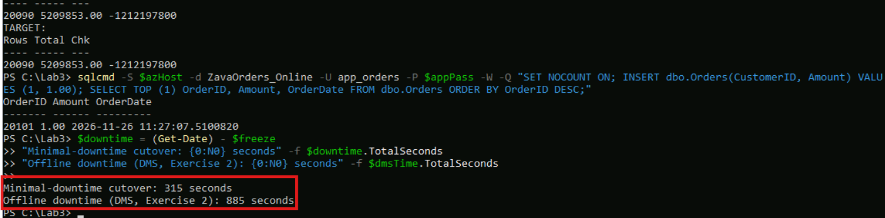

1. **Rollback drill (run only if a go/no-go check failed):**

  +++sqlcmd -S localhost -E -C -Q "ALTER DATABASE ZavaOrders SET READ_WRITE WITH ROLLBACK IMMEDIATE;"+++
  
  If all checks passed, leave the source read-only. It is now your fallback copy until the migration is signed off. 

  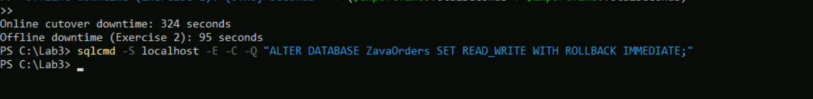

## Clean up and review

### Clean up (Run after the session to stop Azure charges):

    az group delete -n $rg --yes --no-wait
    sqlcmd -S $src -E -C -Q "ALTER DATABASE ZavaOrders SET READ_WRITE WITH ROLLBACK IMMEDIATE; DROP DATABASE ZavaOrders;"
    Set-Location C:\
    Remove-Item C:\Lab3 -Recurse -Force

## Conclusion

In this lab you took Zava Retail’s order database from SQL Server to Azure SQL Database. Profiling the source turned up a blocker before it could cause trouble, and you resolved it. You provisioned Azure Database Migration Service and saw how it reaches on-premises sources. Running an offline migration and an online migration side by side showed the trade-off: the offline copy is simpler, but downtime grows with data size, while the online approach keeps the source writable and shrinks downtime to a short final sync. Finally, you applied settings specific to Azure SQL Database, gated the cutover with automated readiness checks, and finished with a validated switch and a rollback path. Together these steps form a repeatable migration strategy you can apply to larger databases.
